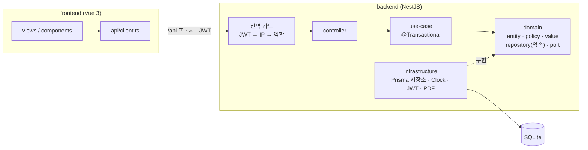
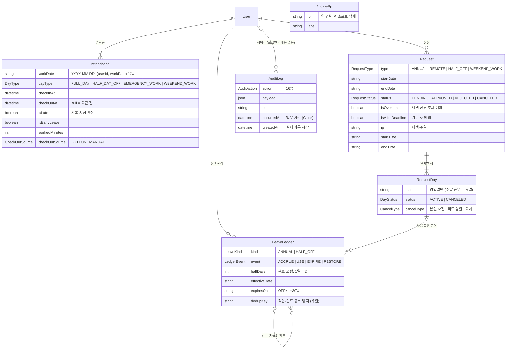

# 팀 근태관리 시스템

하이컨시 과제 **지정 주제 2**. 리드 1명과 팀원 3명이 쓰는 내부 근태관리 웹앱입니다.
과제의 요구사항(FR) 12개, 즉 필수 9개(출퇴근·지각·조퇴, 미기록 퇴근, 신청·잔여, IP 제한, 팀 보드, 이력 등)와 선택 3개(승인·반려, 신청서 PDF, 월별 정산)를 구현했습니다. 선택 기술인 Electron은 쓰지 않았습니다.

- 스택: Vue 3 + NestJS (TypeScript), Prisma + SQLite
- 테스트: 백엔드 단위·유스케이스 344개, 통합(e2e) 7개, 새 환경 시나리오 QA 44개
- 설계 문서: [제도 해석과 결정](docs/decisions.md) · [설계(ERD·API·ADR)](docs/design.md) · [QA 결과](docs/qa.md)

---

## 1. 실행 방법

**필요한 것:** Node.js 22.12 이상 (DB는 SQLite 파일이라 별도 설치 없음)

```bash
git clone https://github.com/doosup/team-attendance-system.git && cd team-attendance-system
npm i            # 루트에서 한 번: backend·frontend 의존성까지 설치
npm run setup    # .env 생성 → DB 마이그레이션 → 시드 데이터
npm run dev      # 백엔드 http://localhost:3000 + 프런트 http://localhost:5173
```

브라우저에서 **http://localhost:5173** 을 엽니다. 3000번 포트는 비어 있어야 합니다(프런트 개발 서버가 `/api`를 3000으로 넘김). 5173이 사용 중이면 Vite가 다음 포트를 쓰고 터미널에 주소를 알려 줍니다.

| 계정 | 이름 | 역할 | 입사일 |
|---|---|---|---|
| `lead` | 이리드 | 리드 | 2025-12-01 |
| `kim` | 김근태 | 팀원 | 2026-01-01 |
| `yeon` | 연차원 | 팀원 | 2026-01-15 |
| `lim` | 임자율 | 팀원 | 2026-02-12 |

비밀번호는 모두 `password123`입니다. 연구실 IP로 `127.0.0.1`이 시드되어 있어 로컬에서 바로 접속됩니다.

**현재 시각 바꾸기:** 판정은 모두 서버 시각 기준입니다. 상단의 시계 버튼(개발 모드)으로 서버의 "현재 시각"을 옮기면 07:00·10:00:01·17:00 같은 경계를 바로 시험할 수 있습니다. 실제 시각으로 되돌리는 버튼도 있습니다. 화면으로 따라 해 보는 순서는 [docs/qa.md](docs/qa.md#4-화면으로-다시-해-보기)에 있습니다.

**테스트**

```bash
npm test             # 단위·유스케이스 (backend)
npm run test:e2e     # 통합: 매번 새 SQLite에 마이그레이션 후 실제 HTTP로 호출
```

<details>
<summary>백엔드·프런트를 따로 띄우려면</summary>

```bash
cd backend && npm run start:dev    # http://localhost:3000
cd frontend && npm run dev         # http://localhost:5173 (/api → 3000 프록시)
```
</details>

---

## 2. 구현 범위

| 요구사항 | 구분 | 구현 |
|---|---|---|
| FR-SYS-01 등록된 IP에서만 접속 | 필수 | 연구실 IP 상시 + 승인된 재택·주말 근무 신청의 IP·시간대만. 차단 시 403과 현재 IP 안내 |
| FR-SYS-02 역할별 화면 | 필수 | JWT 로그인, 팀원/리드 화면 분리, 리드 API는 `/lead/...` |
| FR-ATT-01~02 출퇴근·지각·조퇴 | 필수 | 서버 시각으로 기록, 판정 결과를 기록 시점에 저장 |
| FR-ATT-03 미기록 퇴근 직접 입력 | 필수 | 다음 출근 때 닫을 수 없는 입력 창, 입력 전 퇴근은 서버가 거부, "직접 입력" 표시 |
| FR-ATT-04 주말·공휴일 근무 | 필수 | 신청한 IP·시간대에서만 출퇴근, 퇴근 시 반일 OFF 지급 |
| FR-REQ-01 신청·기한·잔여 검사 | 필수 | 기간 신청(영업일만 차감), 기한·잔여·재택 한도·중복 검사 |
| FR-BAL-01 잔여 자동 계산 | 필수 | 원장 합산: 연차 월 적립, 재택 월 초기화, OFF 지급·30일 만료 |
| FR-DSH-01 팀 보드·내 카드·미기록 | 필수 | 팀원은 상태만, 리드는 시각·지각·조퇴까지 |
| FR-LOG-01 모든 인터랙션 이력 | 필수 | 16종 동작 기록, 리드 화면에서 문장으로 조회 |
| FR-REQ-02 승인·반려 | 선택 | 기간 전체 승인·반려, 리드 당일 취소(하루만) |
| FR-REQ-03 신청서 PDF | 선택 | 정해진 양식(결재란 포함), 본인·리드만 |
| FR-STL-01 월별 정산 | 선택 | 근무일·근무시간·지각·조퇴·잔여, 퇴사자 포함 |

**과제 밖에서 더한 것**

- 리드의 **팀원 등록·퇴사 처리**: 회원가입 대신 리드가 계정을 만듭니다. 퇴사는 소프트 삭제라 기록이 남고, 미래 신청은 자동 취소됩니다
- **기한 후 예외 신청**: 기한(직전 영업일 17:00)이 지나도 사유를 적으면 리드 결재로 받습니다 (급한 주말 출근·경조사)
- **반일 OFF 오전/오후와 반차 예정 시간** 표시, **신청 달력**(공휴일·주말 표시, 종류별로 서버가 거부할 날은 선택 불가), 2027년 공휴일

---

## 3. 기술 스택과 선택 이유

| 영역 | 선택 | 이유 |
|---|---|---|
| 프런트 | Vue 3 (Composition API) · Vite · Pinia · Vue Router | 과제 필수. 화면이 단순해 컴포넌트 라이브러리 없이 기본 HTML·CSS로 |
| 달력 | @vuepic/vue-datepicker | 브라우저 기본 날짜 입력은 공휴일을 칠하거나 날짜를 막을 수 없음. 직접 만들면 키보드 조작·기간 이동까지 새로 짜야 해서 라이브러리로. 공휴일·막을 날은 서버의 `GET /holidays`와 같은 데이터로 판단 |
| 백엔드 | NestJS 11 (TypeScript) | 과제 필수. DI로 Clock·저장소를 갈아 끼울 수 있어 시각 경계 테스트가 쉬움 |
| DB | **SQLite + Prisma 6** | 평가자가 **설치 없이** 실행해야 함. Prisma 스키마가 읽기 쉽고 마이그레이션·시드가 명령 하나. 4명 규모라 동시 쓰기 한계는 문제되지 않음 (ADR-001) |
| 트랜잭션 | nestjs-cls + `@Transactional()` | 신청 → 원장 차감 → 이력처럼 여러 저장소를 한 트랜잭션으로 묶되, 유스케이스가 Prisma를 모르게 |
| 날짜 | dayjs (utc·timezone) | 날짜(`YYYY-MM-DD`, KST)와 순간(UTC)을 구분하고, 판정은 Asia/Seoul로 |
| 인증 | JWT 12시간 + bcrypt | 사내 도구라 세션 저장소 없이 단순하게. 비밀번호는 해시만 저장 |
| 입력 검증 | class-validator | DTO에서 형식 검증 → 업무 규칙은 도메인에서 |
| PDF | pdfkit + 나눔고딕(OFL) | 서버에서 정해진 양식으로 생성. 한글 글꼴을 저장소에 포함해 어디서나 같은 결과 |
| 테스트 | Jest + Supertest | 정책은 순수 함수 단위 테스트, 흐름은 메모리 저장소, 핵심 경로는 실제 SQLite e2e |

외부 API(공휴일 API 등)는 쓰지 않았습니다. 키 발급·네트워크가 필요하면 "clone → 실행"이 깨지기 때문입니다. 공휴일은 2026·2027년을 코드에 넣었습니다.

---

## 4. 아키텍처

배포 인프라는 구축하지 않았습니다(로컬 실행 전용). 아래는 소스 코드 구조입니다.



**헥사고날 구조, 레이어 먼저** (ADR-006·007)

```
backend/src/
├── app/            유스케이스 계층. 기능별 폴더 안에 controller / dto / use-case
│   ├── auth, attendance, request, balance, dashboard, dev
│   └── lead/       리드 전용 (approval, allowed-ip, audit-log, member, settlement …) → 경로 /lead/...
├── domain/         업무 규칙. Nest·Prisma를 import하지 않음
│   ├── entity/     User, Attendance, Request, LedgerEntry, AuditLog …
│   ├── policy/     attendance · request · balance · access · board · settlement (순수 함수)
│   ├── value/      work-date, business-day, holidays
│   ├── repository/ 저장소 약속 (abstract class)
│   ├── port/       Clock, PasswordHasher, Token, PDF 렌더러 약속
│   └── exception/  도메인 에러 코드와 메시지
├── infrastructure/ prisma(저장소 구현·매퍼), clock, token, password, pdf
└── common/         가드(JWT·IP·역할), 응답 인터셉터, 에러 필터, 검증 파이프
```

- **의존 방향은 `app → domain ← infrastructure`.** 도메인 코드는 Nest·Prisma를 import하지 않아 "이 팀의 근태 제도"만 남습니다. ORM을 바꾸면 고칠 곳은 infrastructure와 트랜잭션 어댑터(nestjs-cls의 Prisma 어댑터)로 모입니다. 다만 실제로 교체해 본 적은 없습니다. 저장소 구현은 `repository.module.ts`에서 `{ provide: XRepository, useClass: PrismaXRepository }`로 연결합니다.
- **정책은 순수 함수입니다.** 지각·조퇴·근무시간·기한·한도·잔여 판정은 값만 받아 결과를 돌려줍니다. 현재 시각은 유스케이스가 주입된 `Clock`에서 받아 넘깁니다(`new Date()` 직접 호출 금지). 덕분에 경계값을 DB 없이 밀리초 단위로 테스트합니다.
- **Controller = API = UseCase (1:1:1).** API 목록과 파일이 한 줄씩 대응해 코드를 찾기 쉽습니다. 예: `POST /lead/requests/:id/approve` → `approve-request.controller.ts` / `.dto.ts` / `.use-case.ts`

**요청 하나의 흐름 (출근 버튼)**
JWT 가드 → IP 가드(연구실 또는 승인된 재택·주말 IP·시간대) → `CheckInController` → `CheckInUseCase`가 `Clock.now()`를 받아 그날 신청(반일 OFF·주말 근무·당일 취소)을 조회 → `attendance.policy`가 근무일 유형과 지각을 판정 → 저장 + 이력 기록(한 트랜잭션) → `{ data }` 응답, 미기록 퇴근이 있으면 함께 내려 화면이 입력 창을 띄움

**프런트**는 `views/`(대시보드·신청·리드·로그인·IP 차단), `components/`(시계 패널·직접 입력 창·정산), `api/client.ts`(토큰·401 처리), `stores/`(로그인·서버 시각)로 단순하게 나눴습니다. 업무 판단은 하지 않고 서버 응답을 보여 줍니다.

---

## 5. 컨벤션

| 항목 | 규칙 |
|---|---|
| 파일 | kebab-case, 기능명 + 역할 접미사 (`approve-request.use-case.ts`) |
| 이름 | 클래스 PascalCase, 변수·함수 camelCase, 상수 UPPER_SNAKE |
| 응답 | 성공 `{ data }`, 실패 `{ error: { code, message } }` |
| 에러 | 업무 규칙 위반은 도메인 에러 코드 (`REQUEST_DEADLINE_PASSED`, `IP_NOT_ALLOWED` …, [전체 목록](docs/design.md#도메인-에러-코드-확정)). 코드 → HTTP 상태는 한 곳(`error-status.ts`)에서 |
| 검증 | 형식은 DTO(class-validator, 정의 안 된 필드는 거부), 업무 규칙은 도메인 |
| 시각 | 날짜는 `YYYY-MM-DD`(KST) 문자열, 순간은 UTC. 업무 시각은 Clock, 기술 시각(createdAt)은 DB |
| 기록 | 이력·원장은 추가만. 취소는 상태(CANCELED)로, 삭제는 사용자·IP만 소프트 삭제 |
| 테스트 | 이름은 한국어로 규칙 그대로 (`it('10:00:01 출근은 지각이다')`), 경계값 필수 |
| 작업 단위 | 티켓 하나 = 브랜치 하나 = PR 하나. 브랜치 `feat/ATT-24-check-in`, 커밋 `feat(ATT-24): 출근 등록과 지각 판정 추가` (Conventional Commits) |

---

## 6. DB 스키마와 설계 이유



전체 컬럼·인덱스는 [design.md ERD](docs/design.md#erd)와 [`schema.prisma`](backend/prisma/schema.prisma)에 있습니다.

| 테이블 | 설계 이유 |
|---|---|
| **Attendance** | 사람·근무일당 한 줄(`@@unique([userId, workDate])`)이라 중복 출근이 DB에서도 막힙니다. 지각·조퇴·근무시간은 **기록하는 순간 판정해 저장**합니다. 나중에 규칙이나 공휴일 데이터가 바뀌어도 그날 내린 판정이 바뀌지 않게 하려는 것입니다 |
| **Request + RequestDay** | **정책은 기간, 저장은 날짜** (ADR-004). 사용자는 "11/17~11/21 연차"로 한 번에 신청·승인·취소하고, 내부에는 영업일마다 한 줄씩 저장합니다. 그래서 연차 중간 하루만 리드가 긴급 출근으로 취소하거나, 날짜별 팀 보드·재택 횟수를 셀 수 있습니다. 승인 시점의 영업일이 행으로 고정되어 공휴일 데이터가 바뀌어도 차감 일수가 흔들리지 않습니다 |
| **LeaveLedger** | **잔여를 저장하지 않고 원장 합산**으로 계산합니다 (ADR-002). 통장 거래 내역처럼 적립·사용·만료·복원을 한 줄씩 추가만 하므로 "왜 잔여가 이만큼인가"를 언제든 설명할 수 있고, 취소·반려도 기록을 지우지 않습니다. 반일 OFF는 지급건(`grantId`)마다 만료일을 따로 추적해 **만료 임박 순**으로 씁니다. 단위는 반일(정수 `halfDays`)이라 소수 오차가 없고 연차 반차를 붙이기 쉽습니다 |
| **AuditLog** | 모든 변경을 추가만 합니다(FR-LOG-01). 시각 변경 기능이 있어서 **업무 시각(occurredAt, Clock)과 실제 기록 시각(createdAt)을 둘 다** 남겨, 시각을 옮겨 시험한 기록도 구분됩니다 |
| **AllowedIp** | 연구실 IP. 소프트 삭제라 "살아 있는 것 중 중복"은 DB 유일 제약 대신 유스케이스에서 확인합니다 |

- **취소는 상태, 삭제는 소프트 삭제.** 신청·날짜는 CANCELED로 남겨 통계와 원장이 참조합니다. 사용자(퇴사)·연구실 IP만 `deletedAt`.
- **선택지는 enum**(11종), 독립적인 예/아니오만 Boolean. SQLite에는 enum 타입이 없어 TypeScript 타입 → DTO 검증 → Prisma Client 세 겹으로 지킵니다.
- **인덱스는 실제 조회에 맞춰서**: 팀 보드(`RequestDay(date, status)`, `Attendance(workDate)`), 대기 목록(`Request(status, startDate)`), 이력(`AuditLog(occurredAt)`) 등.

---

## 7. 제도 해석 (애매한 부분을 어떻게 정했나)

원칙: ① 제도 문구를 먼저 따르고 규칙을 더하지 않는다 ② 문구에 없으면 팀원에게 불리하지 않게, 단순하게 ③ 경계는 초 단위, "까지"는 그 시각 포함 ④ 기록은 지우지 않는다 ⑤ 로컬 실행을 해치지 않는다.
모든 결정과 근거, 검토한 대안은 [docs/decisions.md](docs/decisions.md)에 있습니다. 주요한 것만 옮깁니다.

| 질문 | 결정 |
|---|---|
| 지각·기한 경계 | 10:00:00까지 정상, 10:00:01부터 지각. 신청은 시작일의 **직전 영업일** 17:00:00까지 |
| 점심이 일부만 겹치면? | 11:30~12:30 **전체**가 근무 구간에 들어갈 때만 1시간 차감 (12:11 출근 → 차감 없음) |
| 연차 적립일 | 입사 1개월 뒤부터 매월 입사일과 같은 날. 그 날짜가 없는 달은 말일 (1/31 입사 → 2/28) |
| 반일 OFF 사용일 | 지각 판정 없음, 실제 근무 4시간 이상이면 정상, 16:00 퇴근 제한 없음 |
| OFF 지급 | 승인된 주말·공휴일 근무에서 출근·퇴근이 모두 기록되면 **퇴근 시점에** 1개. 지급일 +30일까지 사용, 만료 임박 순 |
| 재택 월 2회 | 재택 날짜가 속한 달 기준, 대기·승인 건 포함. 넘으면 거부 대신 **예외 신청**(사유 필수, 리드 결재) |
| 기한이 지난 신청 | 거부 대신 **기한 후 예외 신청**(사유 필수, 리드 결재). 오늘·지난 날짜는 불가 (지각 뒤 연차로 바꾸기 방지) |
| 신청 취소 | 본인은 기한 전에 기간 전체만. 당일은 **리드만 하루만**, 그날은 "긴급 출근"(지각·조퇴 판정 없음) |
| 미기록 퇴근 | 출근은 즉시 기록, 다음 화면에서 지난 퇴근 시각을 입력해야 퇴근 가능 (서버가 강제) |
| 자정 넘김 | 지원 안 함. 넘기면 미기록 → 다음 출근 때 직접 입력 |
| 팀 보드 공개 범위 | 팀원은 상태만, 리드는 시각·지각·조퇴까지. 반일 OFF 시간대는 일정 정보라 모두에게 |
| 승인 대기 중인 날 | 미승인으로 처리 (재택·주말 IP 열리지 않음, 보드에 "승인 대기") |

---

## 8. 고민한 점

1. **"잔여"를 숫자로 저장하지 않기.** 연차는 매월 쌓이고, OFF는 건마다 만료일이 다르고, 신청·반려·취소·당일 취소·퇴사로 오르내립니다. 숫자 하나를 고쳐 가면 어디서 틀렸는지 알 수 없어서 원장(추가만 하는 이벤트)으로 만들었습니다. 적립·만료는 조회할 때 원장과 동기화하고 `dedupKey`로 두 번 쌓이지 않게 했습니다.
2. **미기록 퇴근을 화면이 아니라 서버가 강제하기.** 출근 버튼을 누르는 순간 서버 시각으로 기록해 입력하다 지각하는 일이 없게 하고, 지난 퇴근을 입력하기 전에는 서버가 퇴근을 거부합니다. 새로고침·다른 기기에서도 같은 결과가 나옵니다 (ADR-005).
3. **시각을 바꿔 시험할 수 있게 하기.** 과제가 권장한 "현재 시각 변경"을 Clock 주입으로 구현했습니다. 모든 판정이 같은 Clock을 쓰므로 시연에서 경계를 재현할 수 있고, 테스트에서는 고정 시계를 씁니다.
4. **제도를 지키면서 현실의 예외 받기.** 재택 한도 초과와 기한 후 신청은 거부하지 않고 "예외 신청"(사유 + 리드 결재)이라는 같은 패턴으로 받았습니다. 규칙은 그대로 두고 판단을 리드에게 넘기는 방식입니다.
5. **기록과 보기를 나누기.** 이력은 로그인까지 모두 남기되, 리드 화면에서는 로그인 성공을 기본으로 숨기고 JSON 대신 "김근태님 연차 11/17~11/18 승인" 같은 문장으로 보여 줍니다.
6. **저장소를 인터페이스와 구현으로 나눌지.** 도메인이 Prisma를 직접 쓰면 파일이 적습니다. 그래도 저장소 약속을 domain에 두고 구현을 분리해, 유스케이스 테스트가 메모리 저장소로 "저장 → 조회" 흐름까지 DB 없이 돌게 했습니다. 대가는 저장소마다 인터페이스 파일이 하나씩 느는 것입니다 (ADR-007).

---

## 9. 아쉬운 점과 확장 방안

**알고 남겨 둔 한계** (코드에 `shortcut:` 주석으로 한계와 개선 시점을 적었습니다)

| 위치 | 지금 | 이럴 때 개선 |
|---|---|---|
| 공휴일 (`holidays.ts`) | 2026·2027년을 코드에 고정 | 임시공휴일이 잦아지면 리드가 화면에서 관리하는 테이블로 |
| 이력 조회 | 최신 200건 | 이력이 많아지면 커서 페이징 |
| 월별 정산 | 사람마다 쿼리 3번 (N+1) | 인원이 늘면 월 단위 일괄 조회 |
| 신청서 PDF 이름 조회 | 이름 두 개를 위해 전체 사용자 조회 | 인원이 늘면 id 목록 조회 |
| 신청서 PDF | 페이지 넘김 없음 (A4 한 장) | 한 달 넘는 기간을 받게 되면 행 단위 페이지 넘김 |

**동시 요청:** SQLite는 쓰기를 한 번에 하나씩 처리합니다. 적립·만료는 조회할 때 원장에 채워 넣는데, 같은 사람의 조회가 동시에 들어와도 `dedupKey` 유일 제약이 두 번째 쓰기를 막습니다. 이때 그 요청은 실패하고, 다시 조회하면 정상으로 나옵니다. 중복 신청과 재택 한도는 트랜잭션 안에서 확인하지만, DB 수준의 조건부 유일 제약은 없습니다. 4명 규모에서는 감수했고, 사람이 늘면 PostgreSQL의 부분 유일 인덱스로 옮기는 것이 다음 단계입니다.

**구현하지 않은 것**

- **연차 반차:** 제도에 없어 만들지 않았지만, 원장이 반일 단위라 차감 단위만 바꾸면 반나절 판정 함수를 그대로 씁니다.
- **유연한 점심·자정 넘김 근무:** 점심 시작·종료 기록, 근무일 귀속 규칙이 필요합니다.
- **휴가 신청은 어디서든:** 지금은 과제 FR-SYS-01("등록된 IP에서만 접속")에 따라 로그인부터 IP 제한을 받아, 밤에 집에서 상을 당해도 "기한 후 예외 신청"을 낼 수 없습니다. IP 제한을 **출퇴근 기록에만** 걸고, 휴가 신청·내 현황 조회는 로그인만으로 어디서든 되게 나누는 것이 다음 단계입니다. 가드를 경로별로 적용하면 되고, 출퇴근 판정 규칙은 그대로입니다.
- **보안 강화:** 비밀번호 재설정(임시 비밀번호 + 첫 로그인 변경), httpOnly 쿠키, 로그인 시도 제한, 연구실 IP 대역(CIDR).
- **화면:** 주말 근무 퇴근 후 "OFF 지급됨" 안내 (지금은 잔여 칸이 바뀌는 것으로만 보임).
- **Electron 메뉴바 위젯 (선택 기술):** 기존 출퇴근 API를 그대로 쓰면 되지만, 평가 환경의 설치 부담 때문에 하지 않았습니다.

---

## 10. 테스트와 검증

| 층 | 무엇을 | 개수 |
|---|---|---|
| 단위 + 유스케이스 | 정책·엔티티 순수 함수(경계값 06:59:59/07:00:00, 10:00:00/10:00:01, 15:59:59/16:00:00, 17:00:00/17:00:01)와, 메모리 저장소·고정 시계로 돌리는 흐름(신청 → 승인 → 취소 → 복원, 퇴사 시 자동 취소 …) | 344개 (38개 파일) |
| 통합(e2e) | 실제 HTTP → 가드 → Prisma → 새 SQLite. 7개 시나리오: ① 출근·퇴근 판정 ② 미기록 시 퇴근 거부와 직접 입력 ③ 신청 → 승인 → 차감 → 취소 → 복원 ④ PDF 응답과 권한 ⑤ 팀원 등록 → 퇴사 → 로그인 거부 ⑥ 등록 안 된 IP 403 ⑦ 팀원의 리드 API 403 | 7개 |
| 시나리오 QA | 깨끗한 clone에서 설치·실행 후 실제 서버로 44개 흐름 | [docs/qa.md](docs/qa.md) |

`npm run typecheck`(백엔드, 테스트 코드 타입까지)와 lint, 프런트 `vue-tsc`도 PR마다 통과시켰습니다.

---

## 11. AI 활용

과제 안내대로 AI 도구(Claude Code)를 적극 썼습니다. 일하는 방식은 다음과 같습니다.

- **먼저 문서, 그다음 코드:** 제도 해석과 API·ERD·ADR을 먼저 확정하고([decisions](docs/decisions.md), [design](docs/design.md)), 바꿀 때는 문서부터 고쳤습니다.
- **티켓 단위 작업:** Notion 작업 보드의 티켓 하나 = 브랜치 하나 = PR 하나. 정책은 테스트 먼저(실패 확인 → 구현).
- **리뷰를 거쳐 머지:** PR마다 자동 코드 리뷰를 돌려 지적을 반영하거나, 반영하지 않은 이유를 PR 본문에 남겼습니다.
- **과제 조건 대조:** 기능을 더할 때마다 과제 원문과 비교했습니다. 예: 반일 OFF 시간 입력은 과제 FN-REQ-01에 없어 필수에서 선택으로 바꿨고, 기한은 제도 조항이라 없애지 않고 예외 신청으로 받았습니다.

---

## 문서

| 문서 | 내용 |
|---|---|
| [docs/decisions.md](docs/decisions.md) | 제도 해석 원칙과 결정·근거·대안, 반일 OFF 예시, 확장 방안 |
| [docs/design.md](docs/design.md) | ERD, 테이블별 설계 이유, 디렉토리 구조, 테스트 전략, API 목록, 에러 코드, ADR-001~007 |
| [docs/qa.md](docs/qa.md) | 새 환경 실행 점검과 시나리오 QA 결과, 화면으로 따라 하기 |
| [docs/workflow.md](docs/workflow.md) | 작업 순서와 티켓 진행 방식 |
