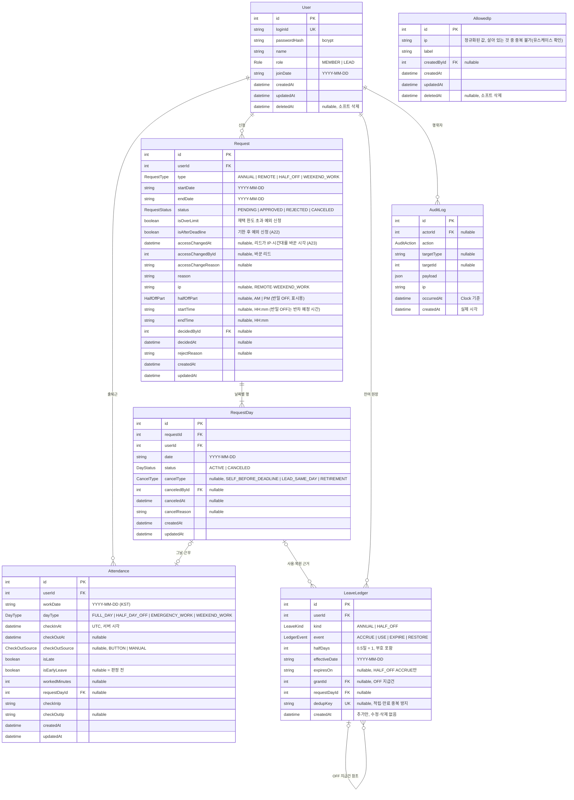

# 설계: 데이터 모델, 구조, API, ADR

> **API 구조 확정 (2026-11-12, 11-13 리드 경로 분리).** 이 문서의 API 목록·요청·응답·에러 코드를 기준으로 구현한다. 바꿔야 할 때는 이 문서를 먼저 고친 뒤 코드를 고친다.
> 제도 해석과 근거는 [decisions.md](./decisions.md).

## 핵심 설계 방향

- **현재 상태와 이력을 나눈다:** Attendance·Request는 지금 상태, 변화의 기록은 AuditLog·LeaveLedger
- **기록은 지우지 않는다:** 원장·이력은 추가만, 사용자·연구실 IP는 소프트 삭제
- **"날짜"와 "순간"을 구분한다:** 근무일·대상일은 `YYYY-MM-DD`(KST) 문자열, 출퇴근 같은 순간은 UTC
- **선택지는 enum, 독립적인 예/아니오만 Boolean**
- **규칙 강제는 화면이 아니라 서버가:** 미기록 퇴근 입력, 권한, 기한은 모두 서버가 판단
- **Clock 주입:** 모든 "현재 시각"은 서버의 Clock에서. 개발 모드에서 시각 변경 가능
- **정책 계층 분리:** 지각·조퇴·근무시간·기한·한도 판정은 순수 함수

## ERD



## 테이블별 설계 이유

### User
- `loginId`는 이름과 분리 (동명이인). `passwordHash`는 bcrypt 해시만 저장 (원문 복원 불가 → 비밀번호는 "찾기"가 아니라 "재설정")
- `role` 하나로 리드·팀원 구분. 리드도 출퇴근하므로 별도 테이블 없음
- `joinDate`는 문자열: DateTime이면 KST 자정이 UTC 전날로 바뀌어 날짜가 밀리는 버그 위험
- `deletedAt` 소프트 삭제: 퇴사자의 기록·원장·이력이 가리키는 대상이 사라지지 않게

### Attendance (한 사람의 하루 = 한 줄)
- `@@unique([userId, workDate])`: 출근 버튼 연타·동시 요청을 DB가 최종 차단
- `dayType`: 그날 적용할 규칙 (반일 OFF면 지각 판정 제외 등). 연차일은 출퇴근 기록 없음
- 판정 결과(`isLate`, `isEarlyLeave`, `workedMinutes`) 저장: 그 시점 기준의 판정 보존 + 대시보드·정산 조회 단순화
- `isEarlyLeave` null = 퇴근 전이라 판정 전 (퇴근·직접 입력 시 시스템이 자동 판정)
- "미기록 퇴근 입력 남음"은 별도 필드 없이 **직전 근무일의 checkOutAt이 null인지**로 판단 → 서버가 항상 같은 답을 줌
- 출퇴근 사건 하나하나는 AuditLog에, Attendance는 그날의 상태만

### Request + RequestDay (정책은 기간, 저장은 날짜)
- Request = 사용자가 낸 신청서 한 장 (기간, 승인 상태, 예외 여부). 네 종류를 한 테이블에: 신청 → 승인 → 취소 흐름과 기한 규칙이 같음
- RequestDay = 신청이 실제로 적용되는 날짜 한 줄씩. 연차·재택은 기간 안의 **영업일만** 행 생성, 반일 OFF·주말 근무는 하루 한 줄
- 본인 취소 = 모든 RequestDay를 CANCELED + Request를 CANCELED (`SELF_BEFORE_DEADLINE`)
- 리드 당일 취소 = 그날 RequestDay 하나만 CANCELED (`LEAD_SAME_DAY`), Request는 APPROVED 유지 → 그날은 긴급 출근
- `isOverLimit`: 재택 한도를 넘는 신청이면 true. 신청서 전체가 예외 신청이 되고, 자동 승인 대상이 아님(리드 본인 제외)
- `isAfterDeadline`: 시작일의 직전 영업일 17:00:00이 지나서 낸 신청이면 true. 사유 필수, 자동 승인 대상이 아님(리드 본인 제외, 결정 A22)
- 잔여 차감·복원, 재택 월 한도, 팀 보드 조회는 모두 RequestDay 기준 (날짜 단위)
- 중복 신청 방지: "같은 사람·같은 날·ACTIVE 행"은 하나여야 하지만 취소 행은 제외해야 해서 단순 유일 제약 불가 → 유스케이스에서 트랜잭션 안에 확인
- `userId`를 RequestDay에도 둔 이유: 날짜별 중복 확인·팀 보드 조회 때 Request를 거치지 않고 바로 찾기 위해
- 머리·상세 구조(주문서·주문 상품과 같은 패턴). 행이 늘어나도 차감·조회·당일 취소가 "행을 세거나 하나 바꾸기"로 끝남 (ADR-004)

### LeaveLedger (통장 거래 내역처럼)
- 잔여 = `halfDays` 합계. 숫자 하나로 저장하면 "왜 이 잔여인지" 설명 불가
- `halfDays` 정수(1일 = 2, 반일 = 1): 소수 오차 없음, 연차 반차 확장 쉬움. 부호 포함이라 합산만 하면 됨
- 사용·복원은 **날짜(RequestDay) 단위로 한 줄씩**: 리드 당일 취소 시 그날 것만 복원
- `grantId` 자기 참조: 반일 OFF는 지급분마다 만료일이 달라, 어느 지급분을 쓰고 만료됐는지 연결 (만료 임박 순 사용, 안 쓴 것만 만료)
- `dedupKey` 유일: 적립·만료는 조회 시점에 "생겼어야 할 것"을 계산해 넣으므로 중복 실행을 DB가 차단. Clock을 앞뒤로 옮겨도 결과 동일. 예: `ACCRUE:ANNUAL:3:2026-02-01`
- null 규칙(ACCRUE엔 grantId 없음, OFF의 USE엔 반드시 있음)은 코드와 테스트로 보장
- 동기화는 `app/balance/sync-ledger.ts` 한 곳: 잔여·원장 조회와 신청(잔여 검사) 전에 "오늘까지 생겼어야 할" 적립·만료를 채운다
- 합산 규칙: 적립·만료는 `effectiveDate ≤ 오늘`인 것만, 사용·복원은 날짜와 무관(신청 시 차감) → 시계를 앞뒤로 옮겨도 그 시점의 잔여가 나옴
- dedupKey: 연차 `ACCRUE:ANNUAL:<userId>:<날짜>`, 주말 근무 OFF `ACCRUE:HALF_OFF:attendance:<출퇴근 id>`, 만료 `EXPIRE:HALF_OFF:<지급 id>:<회차>`

### AuditLog
- `actorId` null = 로그인 실패·IP 차단처럼 아직 누군지 모르는 경우
- `targetType + targetId`: 여러 테이블을 가리키므로 FK 없음 (이력·대상 모두 지우지 않아 문제없음). 가리킬 행이 없는 행동(LOGIN_FAIL·IP_BLOCKED·CLOCK_CHANGE)은 둘 다 null
- `payload` Json: 행동마다 남길 내용이 다름 (SQLite Json은 Prisma 6.2+)
- 시각 두 개: `occurredAt`(Clock 기준 업무 시각), `createdAt`(실제 기록 시각) → 시각을 바꿔 테스트한 기록인지 구분
- 기록하는 행동: CHECK_IN·CHECK_OUT·MANUAL_CHECK_OUT(근무시간·조퇴·OFF 지급), REQUEST_CREATE(자동 승인·예외 표시), LOGIN, LOGIN_FAIL(아이디만, 비밀번호 없음), IP_BLOCKED(메서드·경로), CLOCK_CHANGE(from·to), 승인·반려·취소·IP 관리. **조회는 기록하지 않는다**
- 변경 이력은 그 변경과 **같은 트랜잭션**에 쓴다(변경이 롤백되면 이력도 없음). 거부 자체가 사건인 LOGIN_FAIL·IP_BLOCKED는 트랜잭션 밖에서 먼저 쓰고 거부한다
- 조회 `GET /lead/audit-logs?userId=&from=&to=&includeLogin=`: from·to는 KST 날짜(끝 날짜 포함), occurredAt 최신순 200건. 로그인 성공(LOGIN)은 **기록은 하되** 기본 조회에서 빼고 `includeLogin=true`일 때만 포함(주요 이력이 묻히지 않게, ATT-38). 로그인 실패·IP 차단은 보안상 항상 포함
- 화면은 동작을 한글 이름으로, payload를 문장으로 보여 주고(예: "김근태님 연차 2026-11-17 ~ 2026-11-18 승인") 원본 JSON은 펼쳐 볼 수 있게 둔다

### AllowedIp
- 연구실 IP 상시 허용 목록. 시드 `127.0.0.1`. 리드가 API로 관리
- `ip`는 정규화해서 저장 (`::ffff:127.0.0.1` → `127.0.0.1`, `::1` → 로컬호스트, 앞뒤 공백 제거)
- 재택·주말 근무 IP는 날짜·시간대에 묶여 있어 Request에

### 테이블로 만들지 않은 것
- 공휴일: `domain/value/holidays.ts` (결정 4). 신청 기한·주말 근무 판정을 하는 정책이 쓰므로 domain에 둔다
- 재택 잔여 횟수: 이번 달 살아 있는 REMOTE RequestDay 수로 계산 (따로 저장하면 숫자가 어긋날 위험)
- 현재 시각 변경값: 서버 메모리 (재시작 시 원래 시각으로)

## 생성·수정·삭제 시각과 "취소 vs 삭제" 원칙

| 테이블 | createdAt | updatedAt | deletedAt | 이유 |
| --- | --- | --- | --- | --- |
| User | O | O | O | 퇴사자는 소프트 삭제 (기록이 가리키는 대상 보존) |
| Attendance | O | O | X | 퇴근·직접 입력으로 같은 줄이 바뀜. 근무 기록은 삭제하지 않음 |
| Request | O | O | X | 대기 → 승인·반려·취소로 상태가 바뀜. 삭제 대신 "취소" 상태 |
| RequestDay | O | O | X | 리드 당일 취소로 상태가 바뀜. 삭제 대신 "취소" 상태 |
| LeaveLedger | O | X | X | 통장 거래 내역처럼 한 번 쓰면 고치지 않음. updatedAt을 일부러 빼 "수정 불가" 설계를 드러냄 |
| AuditLog | O (+ occurredAt) | X | X | 이력은 추가만 |
| AllowedIp | O | O | O | 삭제 API는 소프트 삭제. 삭제된 IP를 다시 추가할 수 있도록 `ip` 유일 제약을 빼고, 살아 있는 것 중 중복은 유스케이스에서 확인 |

- **updatedAt과 AuditLog의 역할 분리:** updatedAt은 "마지막으로 바뀐 때"(빠른 확인용), AuditLog는 "언제·누가·무엇을·어떤 값에서 어떤 값으로"(상세 추적용)
- **기술 시각은 실제 시각, 업무 시각은 Clock:** createdAt·updatedAt·deletedAt은 Prisma `@default(now())`·`@updatedAt`이 넣는 실제 서버 시각. 출근 시각·대상일·occurredAt 같은 업무 시각은 Clock 기준
- **취소(CANCELED)는 실제로 일어난 업무 사건**이라 상태로 남김. 통계(취소율, 긴급 출근 횟수)에 쓰이고 원장의 RESTORE가 취소된 RequestDay를 가리킴. 소프트 삭제로 바꾸면 "취소"와 "실수로 지운 것"이 섞여 통계가 깨짐
- **소프트 삭제는 "목록에서 빠져야 하는 대상"에만:** User(퇴사), AllowedIp(사용 중지). 조회 시 항상 `deletedAt: null`
- **화면 정리는 조회 필터로:** 신청 목록 기본은 `status != CANCELED`, "취소 포함 보기" 토글
- **인덱스:** Request `(userId, status)`, `(status, startDate)` / RequestDay `(userId, date, status)`, `(date, status)` / Attendance `(workDate)` / LeaveLedger `(userId, kind)` / AuditLog `(actorId, occurredAt)`, `(occurredAt)`

## Enum 목록

| Enum | 값 |
| --- | --- |
| Role | MEMBER, LEAD |
| DayType | FULL_DAY, HALF_DAY_OFF, EMERGENCY_WORK, WEEKEND_WORK |
| CheckOutSource | BUTTON, MANUAL |
| RequestType | ANNUAL, REMOTE, HALF_OFF, WEEKEND_WORK |
| RequestStatus | PENDING, APPROVED, REJECTED, CANCELED |
| DayStatus | ACTIVE, CANCELED |
| CancelType | SELF_BEFORE_DEADLINE, LEAD_SAME_DAY, RETIREMENT(퇴사 처리로 자동 취소, ATT-32) |
| HalfOffPart | AM(오전 OFF), PM(오후 OFF) — 반일 OFF 신청의 선택 입력, 표시용 (ATT-34) |
| LeaveKind | ANNUAL, HALF_OFF |
| LedgerEvent | ACCRUE, USE, EXPIRE, RESTORE |
| AuditAction | CHECK_IN, CHECK_OUT, MANUAL_CHECK_OUT, REQUEST_CREATE, REQUEST_CANCEL, REQUEST_DAY_CANCEL, REQUEST_APPROVE, REQUEST_REJECT, LOGIN, LOGIN_FAIL, IP_BLOCKED, ALLOWED_IP_ADD, ALLOWED_IP_DELETE, CLOCK_CHANGE, USER_CREATE, USER_RETIRE, REQUEST_ACCESS_CHANGE |

SQLite는 enum 타입이 없어 문자열(TEXT)로 저장되고, 검증은 세 겹: TypeScript 타입 → API 입력(`@IsEnum`) → Prisma Client. DB 수준 강제가 필요하면 CHECK 제약조건 또는 PostgreSQL 전환.

## 디렉토리 구조 (헥사고날, 레이어 먼저)

- 레이어가 먼저(app / domain / infrastructure / common), app 아래는 기능별 폴더, 그 안에서 역할별 디렉토리
- **1:1:1 매핑:** Controller 하나 = API 하나 = UseCase 하나 (dto도 기능명 그대로 하나)
- **리드 전용 기능은 `app/lead/` 아래**, API 경로도 `/lead/...`. 팀원·리드가 함께 쓰는 기능은 `app/` 바로 아래
- **저장소는 인터페이스와 구현을 분리:** domain에는 abstract class(약속)만, Prisma 구현은 infrastructure. 모듈에서 `{ provide: XRepository, useClass: PrismaXRepository }`로 연결

```
backend/src/
├── main.ts
├── app.module.ts
├── app/                                 Application 계층
│   ├── use-case.interface.ts
│   ├── auth/
│   │   ├── controller/   login.controller.ts, get-me.controller.ts
│   │   ├── dto/          login.dto.ts, get-me.dto.ts
│   │   ├── use-case/     login.use-case.ts, get-me.use-case.ts
│   │   └── auth.module.ts
│   ├── attendance/
│   │   ├── controller/   check-in, check-out, manual-check-out, get-today, get-my-month (.controller.ts)
│   │   ├── dto/          check-in.dto.ts, manual-check-out.dto.ts, get-today.dto.ts …
│   │   ├── use-case/     check-in.use-case.ts …
│   │   └── attendance.module.ts
│   ├── request/          create-request, get-my-requests, cancel-request, get-request-pdf (선택), get-holidays
│   ├── balance/          get-my-balance, get-my-ledger
│   ├── dashboard/        get-team-board, get-my-missing-checkouts
│   ├── dev/              get-clock, set-clock, reset-clock (개발 모드에서만 모듈 등록)
│   └── lead/                            리드 전용 (@Roles('LEAD'))
│       ├── approval/     get-pending-requests, approve-request, reject-request, cancel-request-day
│       ├── allowed-ip/   get-allowed-ips, add-allowed-ip, delete-allowed-ip
│       ├── attendance/   get-missing-checkouts (팀 전체)
│       ├── balance/      get-user-ledger
│       ├── audit-log/    get-audit-logs
│       ├── settlement/   get-monthly-settlement (선택)
│       └── member/       get-members, register-member, retire-member (선택, ATT-32)
├── domain/                              Domain 계층 (Nest·Prisma import 금지)
│   ├── entity/           user, attendance, request, request-day, ledger-entry, allowed-ip, audit-log (.entity.ts)
│   ├── repository/       *.repository.ts  ← abstract class (인터페이스)
│   ├── policy/           attendance.policy.ts, request.policy.ts, balance.policy.ts  ← 순수 함수
│   ├── port/             clock.port.ts, request-pdf.port.ts
│   ├── value/            work-date.ts (KST 날짜), business-day.ts, holidays.ts
│   └── exception/        custom.exception.ts, error-code.ts, attendance.exception.ts, request.exception.ts …
├── infrastructure/                      Infrastructure 계층
│   ├── prisma/
│   │   ├── prisma.service.ts, prisma.module.ts
│   │   ├── repository/   prisma-attendance.repository.ts …  ← 구현
│   │   ├── mapper/       attendance.mapper.ts …  (Prisma 모델 ↔ 엔티티)
│   │   └── repository.module.ts  (인터페이스 ↔ 구현 연결)
│   ├── clock/            system.clock.ts, overridable.clock.ts  (clock.port 구현)
│   ├── token/            jwt-token.service.ts
│   └── pdf/              pdfkit-request-pdf.renderer.ts  (request-pdf.port 구현, 나눔고딕은 backend/assets/fonts)
└── common/
    ├── decorators/       current-user, roles
    ├── filters/          domain-exception.filter.ts  → { error: { code, message } }
    ├── guards/           ip.guard.ts, jwt-auth.guard.ts, roles.guard.ts
    ├── interceptors/     response.interceptor.ts  → { data }
    ├── pipes/            validation
    └── utils/            ip.util.ts
```

| 계층 | 디렉토리 | 하는 일 | 하지 않는 일 |
| --- | --- | --- | --- |
| app | controller/ | HTTP 요청 → UseCase 호출 → 응답 | 업무 판단, DB 접근 |
| app | dto/ | 기능별 Request·Result 정의, class-validator 검증, `static from(entity)` | 업무 로직 |
| app | use-case/ | 흐름 조립(조회 → 엔티티·정책에 판정 맡김 → 저장 → 이력), `@Transactional()` | 규칙 계산, Prisma 직접 사용 |
| domain | entity/ | 상태와 자기 규칙 (`attendance.checkOut(now)`, `request.approve(lead)`) | Nest·Prisma 의존 |
| domain | policy/ | 여러 엔티티에 걸친 판정, 순수 함수 | 부수 효과 |
| domain | repository/ | 저장소 약속(abstract class) | 구현 |
| domain | port/ | 외부 의존의 약속 (Clock) | 구현 |
| infrastructure | prisma/repository, mapper | 약속의 Prisma 구현, 모델 ↔ 엔티티 변환 | 업무 판단 |
| common | guards, filters, interceptors … | 인증·권한·IP, 응답·에러 형식 | 업무 판단 |

**의존 방향:** app → domain ← infrastructure. domain은 아무것도 import하지 않는다.

## 테스트 전략

| 층 | 대상 | DB | 비중 |
| --- | --- | --- | --- |
| 단위 | domain의 policy·entity ("10:00:01은 지각", "금~월 연차는 2일 차감") | 필요 없음 (순수 함수) | 약 70% |
| 유스케이스 | app의 use-case 흐름 | 필요 없음 (`InMemoryXRepository` 또는 jest mock) | 약 20% |
| 통합(e2e) | 실제 API → 가드 → Prisma → SQLite | 테스트용 SQLite 파일 | 약 10%, 핵심 흐름만 |

통합 테스트 핵심 흐름: 출근 → 퇴근 → 판정 / 신청 → 승인 → 원장 차감 → 취소 → 복원 / 허용되지 않은 IP는 403 / 미기록 퇴근이 남으면 퇴근 거부

- 실행: `npm run test`(단위·유스케이스), `npm run test:e2e`(통합, `test/app.e2e-spec.ts`)
- e2e는 `DATABASE_URL=file:./e2e.db`로 매번 새 DB에 마이그레이션 후 AppModule 전체(가드·트랜잭션·Prisma)를 띄워 HTTP로 호출. `main.ts`와 같은 설정(`configure-app.ts`)을 쓴다
- 유스케이스 테스트는 `test/fakes/`의 메모리 저장소·고정 시계를 쓰고, `@Transactional()`은 `test/setup-unit.ts`에서 통과시킨다 (실제 트랜잭션은 e2e·수동 롤백 확인으로)
- DB 경로는 `DATABASE_URL`(setup이 `backend/.env`에 `file:./dev.db`로 생성)

경계값 테스트 필수: 06:59:59/07:00:00, 10:00:00/10:00:01, 15:59:59/16:00:00, 17:00:00/17:00:01

## API 목록 (확정)

**공통 규칙**
- 모든 요청은 IpGuard를 통과해야 한다. 로그인 외에는 JWT(12시간) 필요, 만료·누락 시 401
- JWT는 `Authorization: Bearer <token>`. 서명 비밀키 `JWT_SECRET`은 `npm run setup`이 `backend/.env`(gitignore)에 무작위로 만든다. 없으면 서버가 시작하지 않음
- 토큰이 유효해도 요청마다 사용자를 다시 조회해 퇴사(소프트 삭제)자는 401. 역할도 토큰이 아니라 DB 값을 쓴다
- 로그인 실패는 없는 아이디·틀린 비밀번호 모두 같은 `INVALID_CREDENTIALS` (응답 시간도 같게 맞춰 아이디 존재 여부를 숨김)
- 응답: 성공은 `{ data }`, 실패는 `{ error: { code, message } }`
- 날짜 파라미터는 `YYYY-MM-DD`(KST), 시각은 ISO 8601
- 모든 시각 판정은 서버 Clock 기준. 브라우저가 보낸 "현재 시각"은 받지 않음
- `/lead/...` 경로는 리드 전용 (`@Roles('LEAD')`, 팀원은 403 `FORBIDDEN_ROLE`)

| 영역 | Method | Path | 설명 | 권한 | 관련 FR |
| --- | --- | --- | --- | --- | --- |
| 인증 | POST | /auth/login | 로그인 `{ loginId, password }` → `{ accessToken, user }` | 모두 | FR-SYS-02 |
| 인증 | GET | /auth/me | 내 정보와 역할 | 로그인 | FR-SYS-02 |
| 출퇴근 | GET | /attendance/today | 오늘 내 기록, 근무일 유형, 정상 퇴근 가능 시각, `pendingManualCheckouts` | 로그인 | FR-DSH-01, FR-ATT-03 |
| 출퇴근 | POST | /attendance/check-in | 출근. **항상 즉시 기록**(서버 시각), 응답에 `pendingManualCheckouts` 포함 | 로그인 | FR-ATT-01, 04 |
| 출퇴근 | POST | /attendance/:id/manual-check-out | 미기록 퇴근 직접 입력 `{ checkOutAt }` | 본인 | FR-ATT-03 |
| 출퇴근 | POST | /attendance/check-out | 퇴근. 미기록 퇴근이 남아 있으면 `PENDING_MANUAL_CHECKOUT`로 거부 | 로그인 | FR-ATT-02, 04 |
| 출퇴근 | GET | /attendance/me?month= | 내 월별 기록 | 로그인 | FR-DSH-01 |
| 신청 | POST | /requests | 신청 `{ type, startDate, endDate, reason, ip?, halfOffPart?, startTime?, endTime? }`. 재택·주말 근무는 IP·시간대 필수. 반일 OFF는 오전/오후(`AM`·`PM`)와 반차 예정 시간(쉬는 시간대)을 **선택**으로 받음(표시용, 시간을 적으면 둘 다, 결정 A21). 반일 OFF·주말 근무는 startDate = endDate. 재택 한도 초과면 `isOverLimit: true`, 기한 후면 `isAfterDeadline: true`(사유 필수)로 접수. 오늘·지난 날짜는 거부 | 로그인 | FR-REQ-01 |
| 신청 | GET | /requests/me | 내 신청 목록 (날짜별 상태 포함) | 로그인 | FR-REQ-01 |
| 신청 | POST | /requests/:id/cancel | 본인 전체 취소 (시작일의 직전 영업일 17:00:00까지) | 본인 | FR-REQ-01 |
| 신청 | GET | /requests/:id/pdf | 신청서 PDF 내려받기 (선택). `application/pdf` 파일 자체로 응답 (`{ data }` 감싸지 않음) | 본인·리드 | FR-REQ-03 |
| 신청 | GET | /holidays | 공휴일 목록 `[{ date, name }]` (날짜순). 서버 영업일 판정과 같은 데이터라 신청 화면이 날짜 옆에 공휴일·주말을 표시 (ATT-37) | 로그인 | FR-REQ-01 |
| 잔여 | GET | /balances/me | 연차·OFF(만료일 포함) 잔여, 이번 달 재택 `used`(정상)·`exceptions`(예외 신청 일수). 화면은 합계로 "2/2일 + n일 초과" | 로그인 | FR-BAL-01 |
| 잔여 | GET | /balances/me/ledger | 내 원장 내역 | 로그인 | FR-BAL-01 |
| 대시보드 | GET | /dashboard/team?date= | 팀원별 그날 상태. 팀원은 상태만, 리드는 시각·지각·조퇴·10시 경과 미출근 포함 | 로그인 | FR-DSH-01 |
| 대시보드 | GET | /dashboard/me/missing | 내 퇴근 미기록·직접 입력 건 | 로그인 | FR-DSH-01 |
| 대시보드 | GET | /dashboard/calendar?month=YYYY-MM | 팀 일정 달력: 그 달 **확정된** 일정(승인된 신청의 취소 안 된 날짜)만 `{ date, userId, name, type, halfOffPart }`. 대기·반려·취소·퇴사자 제외, 모두에게 같은 필드 (ATT-47) | 로그인 | FR-DSH-01 |
| 리드 | GET | /lead/requests?status=PENDING | 상태별 목록, 기본 대기 (시작일 가까운 순, 신청자 이름·예외 신청 표시) | 리드 | FR-REQ-02 |
| 리드 | POST | /lead/requests/:id/approve | 승인 | 리드 | FR-REQ-02 |
| 리드 | POST | /lead/requests/:id/reject | 반려 `{ rejectReason }` | 리드 | FR-REQ-02 |
| 리드 | POST | /lead/requests/:id/days/:date/cancel | 당일 취소 `{ cancelReason }` → 그날 긴급 출근 | 리드 | FR-REQ-01 |
| 리드 | POST | /lead/requests/:id/access | 재택·주말 근무의 접속 IP·시간대 변경 `{ ip, startTime, endTime, reason }`. 대기·승인 상태이고 오늘 이후 날짜가 남은 것만, 사유 필수, 이력 `REQUEST_ACCESS_CHANGE`(전·후 값) (A23, ATT-42) | 리드 | FR-SYS-01, FR-ATT-04 |
| 리드 | GET | /lead/missing-checkouts | 팀 전체 퇴근 미기록·직접 입력 건 | 리드 | FR-DSH-01 |
| 리드 | GET | /lead/users/:userId/ledger | 팀원 원장 내역 | 리드 | FR-BAL-01 |
| 리드 | GET | /lead/users?includeRetired= | 재직 중인 사용자 목록 `[{ id, loginId, name, role, joinDate, retiredDate }]` (선택, ATT-32). `includeRetired=true`면 퇴사자도(이력 필터·이름 표시용, ATT-38) | 리드 | FR-SYS-02 |
| 리드 | POST | /lead/users | 팀원 등록 `{ loginId, password, name, joinDate }`, 역할은 팀원 고정 (결정 A19) | 리드 | FR-SYS-02 |
| 리드 | DELETE | /lead/users/:id | 퇴사 처리 = 소프트 삭제 + 내일 이후 신청 날짜 자동 취소·원장 복원. 리드는 불가 (결정 A20) | 리드 | FR-SYS-02 |
| 리드 | GET | /lead/allowed-ips | 연구실 IP 목록 | 리드 | FR-SYS-01 |
| 리드 | POST | /lead/allowed-ips | 추가 `{ ip, label }` (형식 검사·정규화) | 리드 | FR-SYS-01 |
| 리드 | DELETE | /lead/allowed-ips/:id | 소프트 삭제 (현재 접속 IP·마지막 IP 불가) | 리드 | FR-SYS-01 |
| 리드 | GET | /lead/audit-logs?userId=&from=&to=&includeLogin= | 인터랙션 이력 (로그인 성공은 includeLogin일 때만) | 리드 | FR-LOG-01 |
| 리드 | GET | /lead/settlements?month= | 월별 정산 (선택). month 없으면 이번 달. 팀원별 근무일·근무시간·지각·조퇴·직접 입력·미기록·연차/OFF 사용·재택·잔여 | 리드 | FR-STL-01 |
| 개발 | GET / PUT / DELETE | /dev/clock | 현재 시각 조회·변경·초기화 | 개발 모드 | 참고사항 |

**미기록 퇴근 흐름**

```
출근 버튼 → POST /attendance/check-in
  → 출근 즉시 기록, 응답 { attendance, pendingManualCheckouts: [{ id, workDate, checkInAt }] }
  → 목록이 비어 있지 않으면 ManualCheckOutModal (이름·날짜 표시, 닫기 없음, 로그아웃 링크)
  → 새로고침·재로그인·다른 기기: GET /attendance/today 가 다시 알려 줌 → 창이 다시 뜸
  → POST /attendance/:id/manual-check-out { checkOutAt }  (그날 출근 시각 ~ 23:59:59)
  → 입력 전 퇴근 요청은 서버가 PENDING_MANUAL_CHECKOUT 으로 거부
```

**개발용 시각 변경 (`/dev/clock`)**
- `NODE_ENV`가 `production`이 아닐 때만 모듈을 등록한다 (아니면 404). 평가자의 `start:dev`에서는 켜져 있다
- `PUT { "now": "2026-11-13T09:59:50+09:00" }`: 오프셋(`Z` 또는 `±hh:mm`)이 있는 ISO 8601만 허용, 아니면 400 `VALIDATION_FAILED`
- 업무 시각은 **초 단위로 자른다** (Clock 한 곳에서): ms 차이로 지각·조퇴가 갈리지 않게 (결정 원칙 3)
- 바꾼 뒤에도 시간은 흐른다: 실제 시각과의 차이만 서버 메모리에 저장 (09:59:50으로 바꾸고 10초 뒤 = 10:00:00). 재시작·`DELETE` 시 실제 시각
- 응답 (GET·PUT·DELETE 공통): `{ data: { now: "<ISO 8601 UTC>", overridden: boolean } }`

**팀 보드 (`GET /dashboard/team?date=`)**
- 상태: WORKING(출근) / LEFT(퇴근) / REMOTE(재택 근무 중) / ANNUAL(연차) / HALF_OFF(반일 OFF, 출근 전) / PENDING_APPROVAL(승인 대기) / NOT_CHECKED_IN(미출근) / DAY_OFF(주말·공휴일)
- 판정은 `domain/policy/board.policy.ts` 순수 함수. 저장소의 날짜별 조회(출퇴근·신청 날짜)를 모아 넘긴다 → query 계층 없이도 테스트 가능해 팀 보드는 저장소를 쓴다
- 팀원 응답은 `{ userId, name, status, halfOff? }`만(승인된 반일 OFF의 `{ part, startTime, endTime }` — 오전/오후·반차 예정 시간은 일정 정보라 모두에게, 결정 A21), 리드는 근무 유형·출퇴근 시각·지각·조퇴·근무시간·직접 입력 여부·`pastTen`(10:00 지나도 미출근)까지

**팀 일정 달력 (`GET /dashboard/calendar?month=`)**
- "누가 언제 없는지/어디서 일하는지"를 미리 보는 화면용. 확정된 것만: `Request.status = APPROVED` 이고 `RequestDay.status = ACTIVE`. 리드 당일 취소한 날은 빠진다
- 이름·종류·반일 OFF 오전/오후만. IP·사유·출퇴근 시각은 넣지 않는다(일정 정보만, 결정 16·A21과 같은 기준). 리드도 같은 필드
- 재직자만(`deletedAt: null`, 팀 보드와 같은 기준). `month` 형식이 틀리면 400 `VALIDATION_FAILED`, 없으면 이번 달(Clock)

**신청서 PDF (`GET /requests/:id/pdf`)**
- 권한: 본인 신청은 본인, 모든 신청은 리드. 팀원이 남의 신청을 요청하면 **없는 신청과 같은 404 `REQUEST_NOT_FOUND`** (본인 취소와 같은 규칙, 존재 여부를 드러내지 않음). 화면도 내 신청 목록·리드 신청 목록에만 버튼을 둔다
- 상태와 상관없이 발급한다 (대기·승인·반려·취소). 상태·날짜별 취소·결재란에 그대로 보여 준다
- 양식: 제목(종류) → 신청 정보 표(신청자·종류·기간·적용 날짜·IP·시간대·사유·상태·반려 사유) → 리드 결재란 → 발급 시각(Clock, KST)
- 렌더링은 `domain/port/request-pdf.port.ts`(포트) ↔ `infrastructure/pdf`(pdfkit 구현). 유스케이스는 이름을 채운 `RequestDocument`만 넘긴다 → 라이브러리를 바꿔도 app은 그대로
- 한글은 PDF 기본 글꼴에 없어 나눔고딕(OFL)을 넣는다. 서버에서 만드는 이유: 브라우저 인쇄는 양식이 브라우저마다 달라지고, 서버 시각으로 발급 시각을 찍어야 해서
- 내려받기는 조회라 이력을 남기지 않는다 (결정 A14)

**월별 정산 (`GET /lead/settlements?month=`)**
- 응답: `{ month, asOf, rows: [{ userId, name, retiredDate, workDays, workedMinutes, lateCount, earlyLeaveCount, manualCount, missingCount, annualUsedDays, halfOffUsed, remote: { used, exceptions }, annualBalanceDays, halfOffBalance }] }`
- 판정은 `domain/policy/settlement.policy.ts` 순수 함수. 출퇴근에 저장해 둔 판정(isLate·isEarlyLeave·workedMinutes)을 모으기만 한다 (판정 결과 저장의 이유)
- 처음 설계는 `infrastructure/query`에서 바로 집계였으나, app → infrastructure 의존이 생겨 팀 보드와 같은 "저장소 + 순수 정책"으로 바꿈
- 잔여 기준일(`asOf`): 지난달은 말일, 이번 달·미래 달은 오늘. 기준일까지 효력이 생긴 원장만 합산 → 지난달 정산이 이후 신청으로 바뀌지 않는다 (결정 A18)
- 대상: 그 달에 재직한 날이 있는 사람 (입사일 ≤ 말일, 퇴사일 ≥ 1일). 퇴사자도 포함하고 `retiredDate`(KST 날짜)로 표시, 입사 전 달에는 행이 없다 (결정 A20)

**팀원 등록·퇴사 (`/lead/users`, ATT-32)**
- 회원가입 대신 리드가 등록한다: 입사일이 연차 적립 기준이라 본인이 정하면 안 됨 (결정 A19)
- 퇴사 = `deletedAt`(Clock 시각). 기존 `deletedAt: null` 조회 규칙 덕분에 로그인(401)·팀 보드에서는 따로 손대지 않아도 빠진다. 리드 신청 목록·팀 미기록은 신청·출퇴근 행 기준이라 재직자 이름이 있는 행만 남긴다
- 원장은 추가 전용이라 정산에서 퇴사자를 동기화할 때 퇴사일까지만 채운다 (퇴사 뒤 연차 적립이 영구히 남지 않게)
- 아이디 중복(퇴사자 포함)은 `loginId @unique`가 최종 차단하고 저장소가 P2002를 `DUPLICATE_LOGIN_ID`로 바꾼다 (동시 등록도 409)
- 퇴사자를 남겨야 하는 조회만 `findAllIncludingRetired()`를 쓴다: 월별 정산, 신청서 PDF의 이름
- 자동 취소는 `Request.cancelForRetirement()`(엔티티: 승인은 내일 이후만, 대기는 전부) → 원장 복원은 본인 취소와 같은 `restoreDrafts` → 이력 `USER_RETIRE`에 취소한 날짜 수·복원량

**IP 검사 (IpGuard, 전역)**
- 가드 순서: JwtAuthGuard → IpGuard → RolesGuard. 재택 IP는 신청한 본인에게만 열려야 해서 사용자를 먼저 안다
- 연구실 IP(AllowedIp, 소프트 삭제 제외)는 상시 허용
- 그 밖의 IP: 오늘 **승인된** 재택·주말 근무 신청의 ACTIVE 날짜 + 신청 IP 일치 + 지금이 신청 시간대 [시작, 종료] 안 + **신청자 본인**
- 접속 IP: 화면은 Vite 프록시(`/api`)를 거치므로 프록시가 `X-Forwarded-For`로 실제 IP를 넘기고, 백엔드는 `trust proxy = loopback`으로 **같은 컴퓨터에서 온 헤더만** 믿는다 (외부 위조 무시)
- 로그인처럼 사용자를 모르는 요청은 그 IP·시간대의 승인 신청이 하나라도 있으면 통과 (로그인 뒤 요청부터 본인 확인)
- 토큰 없이 막힌 IP에서 보호된 경로를 부르면 401이 먼저 나온다 → 화면은 로그인 → 로그인 요청에서 403

**IP 차단 흐름:** 403 `IP_NOT_ALLOWED` → 화면에 "등록된 IP가 아닙니다 (현재 IP: x.x.x.x)" 안내 페이지

## 도메인 에러 코드 (확정)

| 코드 | HTTP | 상황 |
| --- | --- | --- |
| UNAUTHORIZED | 401 | 토큰 없음·만료 |
| FORBIDDEN_ROLE | 403 | 권한 없음 (팀원이 리드 기능 호출) |
| IP_NOT_ALLOWED | 403 | 허용되지 않은 IP 또는 시간대 |
| INVALID_CREDENTIALS | 401 | 로그인 실패 |
| CHECK_IN_TOO_EARLY | 422 | 07:00:00 이전 출근 |
| ALREADY_CHECKED_IN | 409 | 중복 출근 |
| NOT_CHECKED_IN | 409 | 출근 없이 퇴근 |
| ALREADY_CHECKED_OUT | 409 | 같은 날 두 번째 퇴근 (처음 기록을 덮어쓰지 않음) |
| CHECK_OUT_TOO_EARLY | 422 | 일반일 16:00:00 이전 퇴근 (반일 OFF·긴급 출근·주말 근무 날 제외) |
| PENDING_MANUAL_CHECKOUT | 409 | 미기록 퇴근 입력 전 퇴근 시도 |
| MANUAL_CHECKOUT_OUT_OF_RANGE | 422 | 직접 입력 시각이 출근~23:59:59 밖 |
| MANUAL_CHECKOUT_NOT_PENDING | 409 | 직접 입력 대상(직전 근무일의 미기록 1건)이 아님. 남의 기록·오늘 기록·이미 입력한 기록 모두 같은 응답 |
| INVALID_DATE_RANGE | 422 | 종료일이 시작일보다 이르거나, 하루만 가능한 종류에 기간을 넣음, 공휴일 데이터가 없는 연도 |
| NO_BUSINESS_DAY_IN_RANGE | 422 | 연차·재택 기간에 영업일이 하나도 없음 |
| REQUEST_DEADLINE_PASSED | 422 | 시작일의 직전 영업일 17:00:00 이후 본인 취소 (신청은 기한 후 예외 신청으로 받음) |
| PAST_DATE_REQUEST | 422 | 오늘이나 지난 날짜 신청 (기한 후 예외 신청도 내일부터, A22) |
| LATE_REASON_REQUIRED | 422 | 기한 후 예외 신청에 사유가 없음 (A22) |
| INSUFFICIENT_BALANCE | 422 | 연차·OFF 잔여 부족 |
| WEEKEND_WORK_NOT_HOLIDAY | 422 | 영업일에 주말·공휴일 근무 신청 |
| OVERLAPPING_REQUEST | 409 | 이미 신청이 있는 날짜와 겹침 |
| SAME_DAY_CANCEL_LEAD_ONLY | 403 | 팀원이 기한 지난 뒤 진행 중인(오늘이 기간 안) 신청을 취소하려 함 → 리드 당일 취소 안내 |
| NOT_SAME_DAY | 422 | 리드 당일 취소에 오늘이 아닌 날짜 |
| INVALID_STATUS_TRANSITION | 409 | 이미 처리된 신청 승인·반려·취소·IP 변경 |
| ACCESS_CHANGE_NOT_ALLOWED | 422 | 재택·주말 근무가 아니거나, 오늘 이후 날짜가 남지 않은 신청의 IP·시간대 변경 (A23) |
| REQUEST_NOT_FOUND | 404 | 없는 신청을 승인·반려·취소 |
| INVALID_IP_FORMAT | 422 | IP 형식 오류 (연구실 IP, 재택·주말 근무 신청) |
| OVER_LIMIT_REASON_REQUIRED | 422 | 재택 한도를 넘는 예외 신청에 사유가 없음 |
| CANNOT_DELETE_CURRENT_IP | 409 | 현재 접속 중인 IP 삭제 시도 |
| CANNOT_DELETE_LAST_IP | 409 | 마지막 남은 연구실 IP 삭제 시도 |
| DUPLICATE_LOGIN_ID | 409 | 팀원 등록 시 이미 있는 아이디 (퇴사자 포함) |
| JOIN_DATE_IN_FUTURE | 422 | 팀원 등록 시 입사일이 오늘 이후 |
| CANNOT_RETIRE_LEAD | 409 | 리드(본인 포함)를 퇴사 처리 |
| DUPLICATE_ALLOWED_IP | 409 | 살아 있는 연구실 IP와 같은 IP 추가 (정규화 후 비교) |
| ALLOWED_IP_NOT_FOUND | 404 | 없거나 이미 삭제된 연구실 IP 삭제 |
| ON_ANNUAL_LEAVE | 409 | 승인된 연차일에 출근 시도 (출근이 필요하면 리드 당일 취소 → 긴급 출근) |
| WEEKEND_WORK_NOT_APPROVED | 403 | 승인된 주말·공휴일 근무 신청 없이 주말·공휴일 출근 (FR-ATT-04) |
| USER_NOT_FOUND | 404 | 리드가 없는(또는 퇴사한) 사용자의 원장 조회·퇴사 처리 |
| VALIDATION_FAILED | 400 | 입력 형식 오류 (DTO 검증) |

재택 한도 초과와 기한 후 신청은 에러가 아니라 예외 신청(`isOverLimit: true` / `isAfterDeadline: true`)으로 접수된다.

표에 없는 HTTP 오류(존재하지 않는 경로 등)는 상태 이름을 코드로 쓴다 (예: 404 `NOT_FOUND`). 예상하지 못한 오류는 500 `INTERNAL_ERROR`.

## ADR (설계 결정 기록)

### ADR-001 DB: SQLite + Prisma
- **결정:** SQLite 파일 DB, ORM은 Prisma
- **이유:** 평가자가 별도 설치 없이 실행 가능 (과제 필수 조건). Prisma 스키마는 읽기 쉽고 `prisma studio`로 데이터를 바로 볼 수 있음. Prisma 6.2+는 SQLite에서도 enum·Json 지원
- **대안:** PostgreSQL + Docker (평가자 환경에 Docker 필요), JSON 파일 (조회·제약조건을 직접 구현해야 함)
- **감수한 점:** 동시 쓰기에 약함, DB 수준 enum 강제 없음 → 4명 규모에서는 문제없고, 검증은 앱에서 세 겹

### ADR-002 잔여는 원장으로 관리
- **결정:** 잔여 숫자를 저장하지 않고 ACCRUE·USE·EXPIRE·RESTORE 이벤트 합산
- **이유:** "왜 이 잔여인가"를 언제든 설명 가능, 취소·반려 시 기록을 지우지 않음(FR-LOG-01), OFF별 만료일 추적 가능
- **감수한 점:** 조회 시 합산 필요 → 사용자당 이벤트 수가 적어 문제없음

### ADR-003 Clock 주입
- **결정:** `Date.now()` 대신 주입된 Clock(domain/port의 약속, infrastructure/clock의 구현) 사용, 개발 모드에서 시각 변경 API 제공
- **이유:** 과제 참고사항 권장, 07:00·10:00:00·17:00:00 같은 경계를 테스트와 시연에서 재현 가능
- **감수한 점:** 모든 유스케이스가 Clock에 의존 → 리뷰로 `new Date()` 직접 사용 금지

### ADR-004 신청은 기간, 저장은 날짜 (Request + RequestDay)
- **결정:** 사용자는 기간으로 신청·승인·전체 취소, 내부적으로는 영업일마다 RequestDay 행
- **이유:** 신청한 단위 그대로 한 번에 취소하는 게 자연스러움. 동시에 리드 당일 취소(하루만), 영업일만 차감, 날짜별 팀 보드 조회는 날짜 단위가 필요
- **대안:** 1건 = 하루 (신청·승인·취소 반복으로 번거로움) / 기간만 저장 (연차 중간 하루 긴급 출근 시 기간 전체를 취소해야 하고 남은 날은 기한이 지나 재신청 불가) / 기간 + 예외만 기록 (줄 수는 적지만 "기간 → 영업일" 계산이 코드로 흩어져 버그 지점이 늘고, 공휴일 데이터가 바뀌면 승인된 연차의 차감 일수가 달라질 수 있음)
- **감수한 점:** 테이블 하나 추가, 신청 시 영업일 계산 필요

### ADR-005 미기록 퇴근은 서버 상태로 강제
- **결정:** 출근은 버튼을 누른 순간 서버 시각으로 즉시 기록, 미기록 퇴근 입력은 서버가 "남음" 상태를 들고 있다가 화면에 강제, 입력 전 퇴근은 서버가 거부
- **이유:** 급한 출근을 막지 않으면서(지각 방지) 잊지 않게 함. 새로고침·재로그인·다른 기기에서도 같은 결과, 브라우저 시계 조작 불가
- **대안:** 입력이 끝나야 출근 처리 (회상 시간이 업무시간에서 빠지지만 입력하다 지각이 될 수 있음), 나중에 입력 허용 (다시 잊을 수 있음)
- **감수한 점:** 회상 시간(보통 1분 이내)이 업무시간에 포함됨, API 호출 두 번

### ADR-006 헥사고날 구조: 레이어 먼저, 1:1:1 매핑, 리드 경로 분리
- **결정:** `app / domain / infrastructure / common` 레이어 먼저, app 아래 기능별 폴더에 controller·dto·use-case. Controller = API = UseCase 1:1:1. 리드 전용 기능은 `app/lead/`와 `/lead/...` 경로
- **이유:** 이전 NestJS + Prisma 헥사고날 프로젝트에서 검증한 익숙한 구조라 빠르게 작업 가능. API 목록과 파일이 1:1로 대응해 코드를 찾기 쉬움. 리드 기능이 폴더와 경로에서 한눈에 구분됨
- **대안:** 도메인 먼저(attendance/ 안에 모든 레이어) → 엔티티를 여러 기능이 공유하는 이 과제에서는 레이어 먼저가 더 자연스러움. 역할 구분 없이 가드만 사용 → 리드 기능이 코드에서 덜 드러남
- **감수한 점:** 파일 수 증가, 한 기능을 고칠 때 app·domain·infrastructure를 오감

### ADR-007 저장소는 인터페이스(domain)와 Prisma 구현(infrastructure)으로 분리
- **결정:** domain/repository에는 abstract class만, infrastructure/prisma/repository에 Prisma 구현, 모듈에서 연결
- **이유:** **의존성 역전 원칙(DIP).** 업무 규칙(domain)이 세부 도구(Prisma·Nest)에 기대지 않고 둘 다 약속(인터페이스)에 기대게 함. domain에는 프레임워크 import가 없어 "이 팀의 근태 제도"만 코드로 남고, ORM·DB를 바꾸거나(SQLite → PostgreSQL) 버전을 올려도 domain은 그대로. 테스트는 jest mock 또는 메모리 가짜 저장소 모두 가능하며, 가짜 저장소는 상태를 기억해 "저장 → 조회" 흐름 테스트가 자연스러움
- **대안:** domain의 저장소 클래스가 PrismaService를 직접 사용 → 파일이 적고 익숙하며 유스케이스 테스트도 jest mock으로 가능(테스트 가능성은 차이 없음). 다만 domain이 Prisma를 import해 DB·ORM 교체 시 domain도 수정해야 하고 헥사고날 원칙과 어긋남. 실용적 타협으로는 타당하지만, 이번에는 설계 의도를 끝까지 일관되게 지키는 쪽을 선택
- **감수한 점:** 저장소마다 인터페이스 파일 하나 추가. Prisma 쿼리 자체의 정확성은 통합 테스트로 확인
